# AquaSample

Aplicación Android para digitalizar el muestreo de choritos (*Mytilus chilensis*) en centros de cultivo de **ALDEMAR SpA**. Registra ubicación, conteo, calibre, fotografías y condiciones marinas; funciona sin conexión y sincroniza con un backend Spring Boot cuando vuelve la red.

[](https://developer.android.com)
[](https://kotlinlang.org)
[](https://developer.android.com/jetpack/compose)
[](https://spring.io/projects/spring-boot)
[](#testing-y-calidad)
[](https://aquasample-backend.onrender.com/api/health)

## Enlaces rápidos

| Recurso | Enlace |
|---|---|
| APK firmada 1.0.24 | [AquaSample-1.0.24-release.apk](https://github.com/DiegoDV16/AquaSample/raw/v1.0.24/dist/AquaSample-1.0.24-release.apk) |
| Backend en Render | https://aquasample-backend.onrender.com/ |
| Swagger público | https://aquasample-backend.onrender.com/swagger-ui.html |
| Repositorio | https://github.com/DiegoDV16/AquaSample |
| Informe de estado v9 | [AquaSample-Estado-del-Sistema-v9.docx](docs/informe/AquaSample-Estado-del-Sistema-v9.docx) |
| OpenAPI | [docs/openapi.json](docs/openapi.json) |

## Problema y solución

El registro manual de muestras en terreno produce pérdida de datos, fotos sin trazabilidad y dificultad para comparar calibres por tren, línea y período.

AquaSample resuelve esto con:

- Un asistente móvil de tres pasos: **ubicación → conteo/calibre → evidencia**.
- Cámara y conteo asistido sobre la fotografía.
- Persistencia local **Room** y sincronización **WorkManager** con el backend.
- Historial filtrable, dashboard, comparación de períodos y reportes PDF/CSV.
- Roles operador, analista y administrador.
- Backend Spring Boot con JWT, H2, Flyway y Swagger.
- API externa **Open-Meteo** para oleaje, temperatura del mar y viento.

## Flujo de la aplicación Android

### 1. Acceso y panel principal

| Login por rol | Inicio del operador |
|---|---|
| 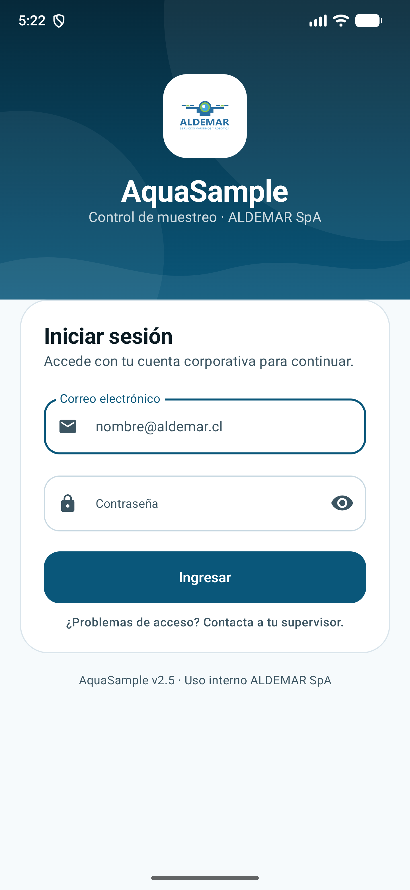 | 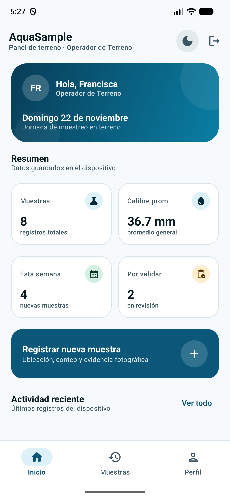 |

El operador inicia sesión con JWT, ve el resumen de muestras del día, el acceso rápido a **Registrar nueva muestra** y el estado de sincronización.

### 2. Registro de una muestra

| Paso 1 · Ubicación | Paso 2 · Conteo y calibre | Paso 3 · Evidencia |
|---|---|---|
| 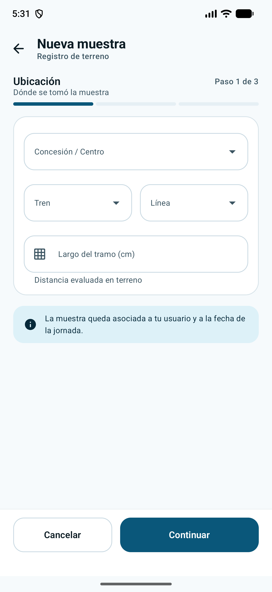 | 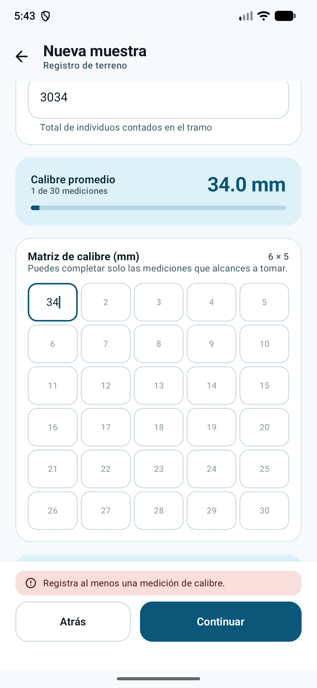 | 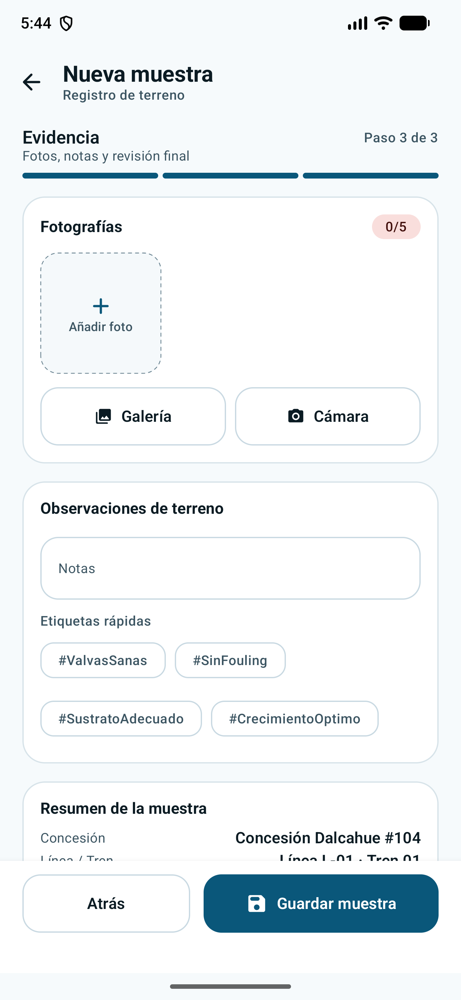 |

El asistente selecciona centro, tren, línea y tramo; luego registra conteo manual, matriz de calibre y observaciones; finalmente adjunta la fotografía.

### 3. Validaciones del asistente

| Validación de ubicación | Validación de evidencia |
|---|---|
| 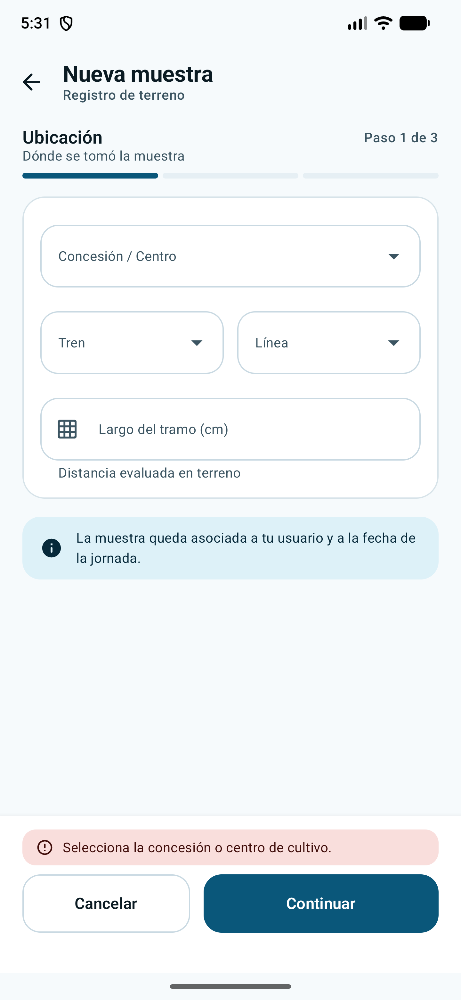 | 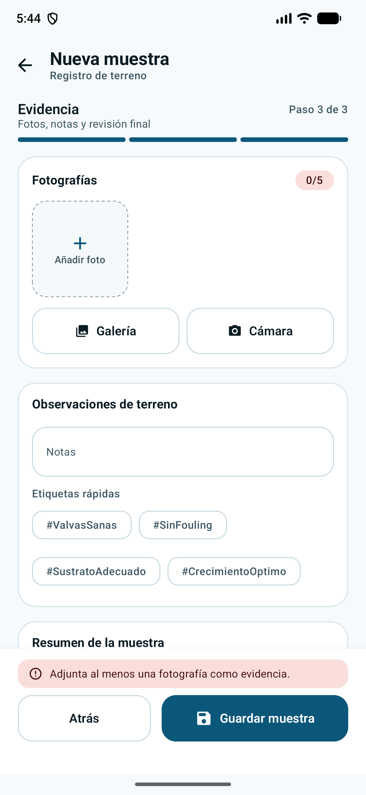 |

El asistente no permite guardar si falta el centro, el tramo o al menos una fotografía; muestra el error junto al botón de avance. El conteo asistido se realiza sobre la foto dentro del flujo de cámara.

### 4. Historial, detalle y reportes

| Historial | Filtros | Detalle y trazabilidad |
|---|---|---|
| 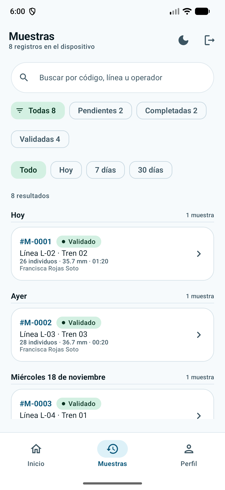 | 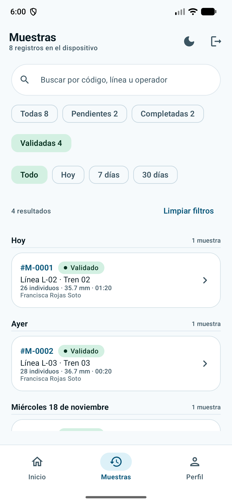 | 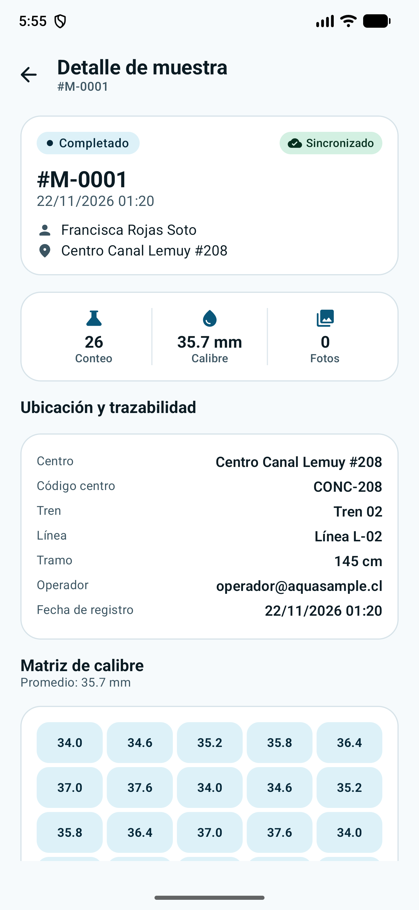 |

| Dashboard | Comparación de períodos | Informe PDF |
|---|---|---|
| 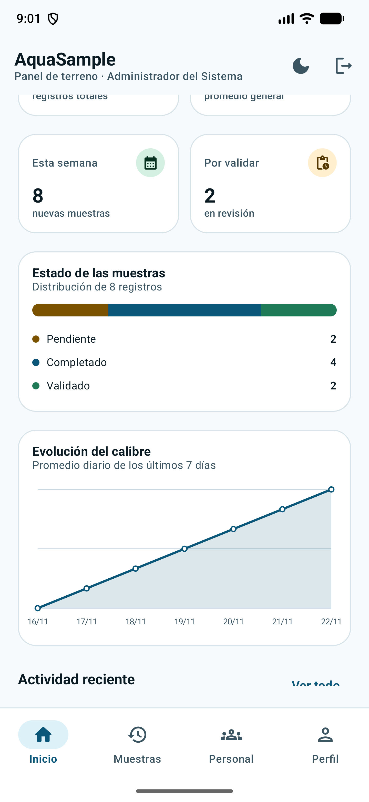 | 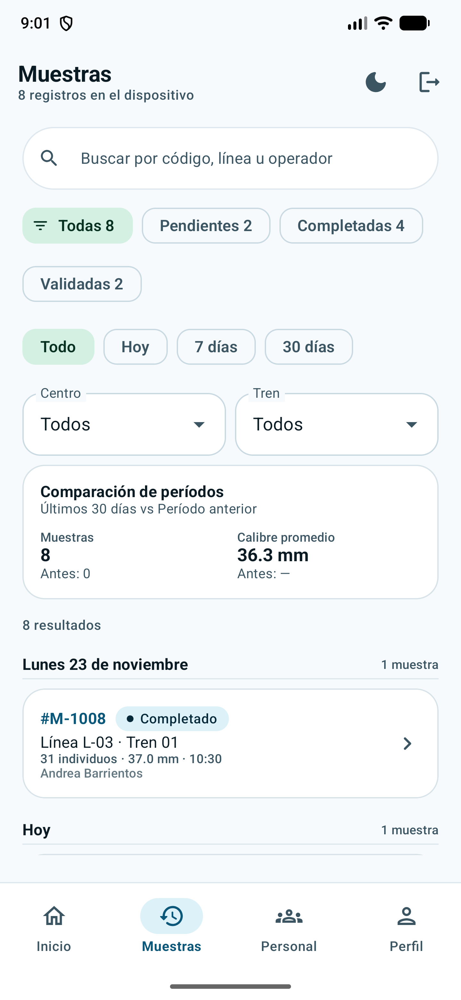 | 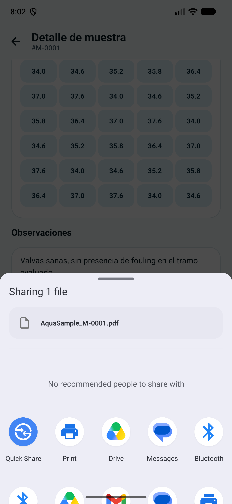 |

### 5. Perfil, administración y sesión

| Perfil y servidor | Gestión de personal | Notificación de pendientes |
|---|---|---|
| 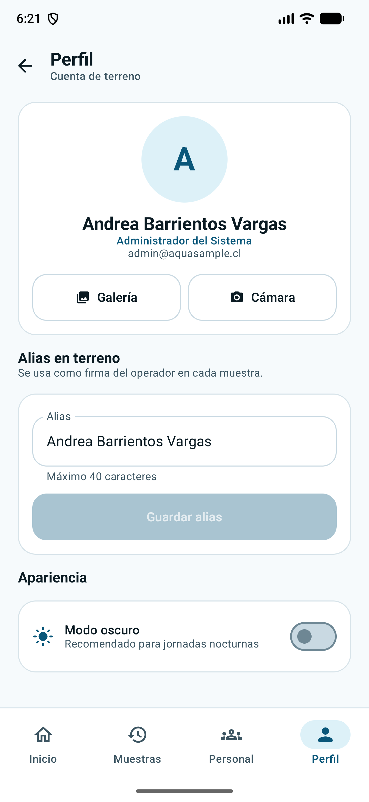 | 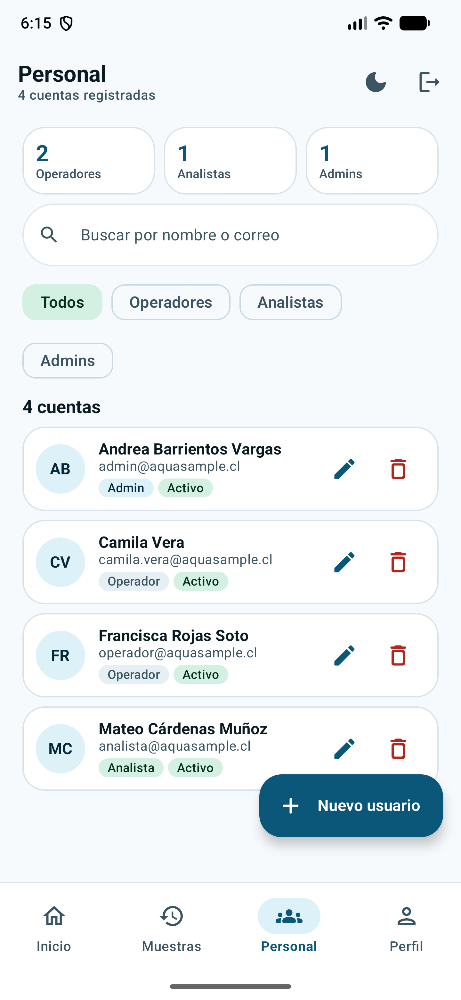 | 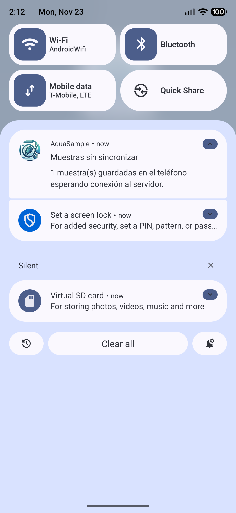 |

| Sesión persistente | Sesión expirada (401) |
|---|---|
| 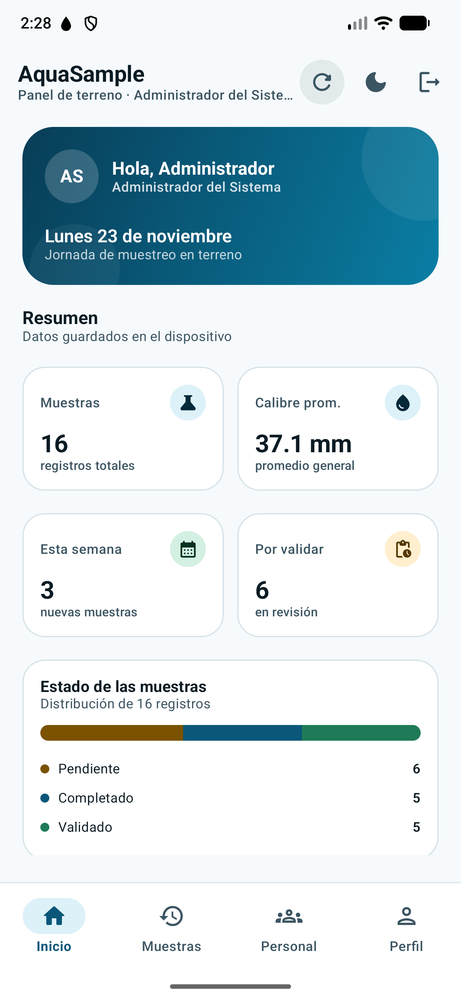 | 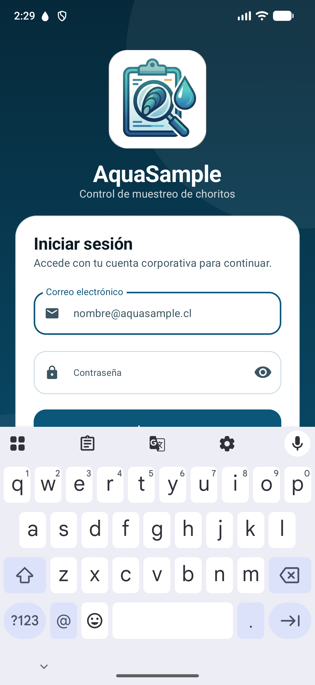 |

## Flujo del backend y APIs

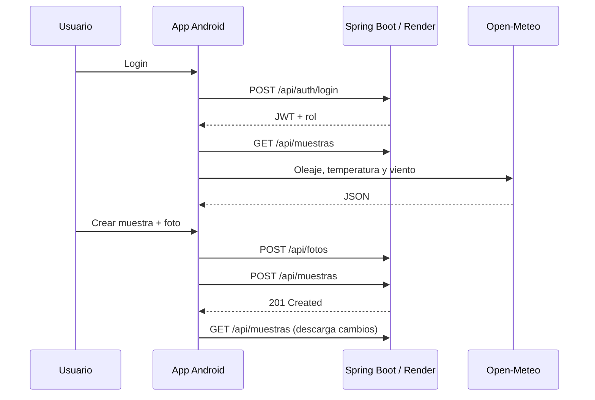

| Swagger / API propia | Health en Render | Open-Meteo Marine |
|---|---|---|
| 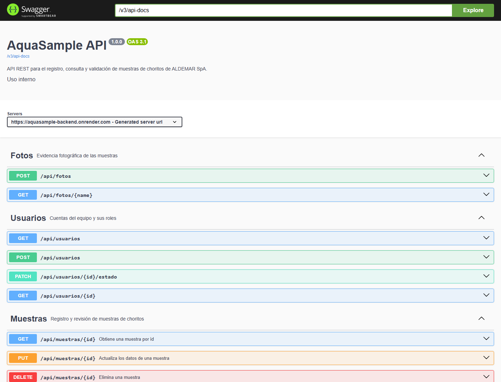 | 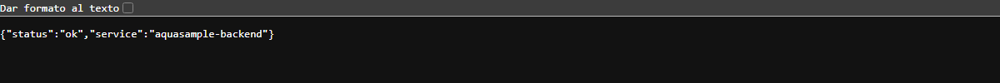 | 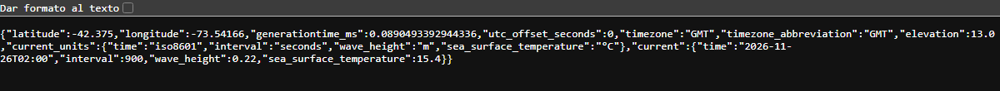 |

- **Swagger:** documenta y permite probar los endpoints de muestras, fotos, centros, tramos y usuarios.
- **Health:** confirma que el backend Docker está activo en Render.
- **Open-Meteo:** entrega oleaje y temperatura del mar; el viento se consulta a la API Forecast.
- **Postman:** colección completa en [postman/](postman/).


## Funcionalidades

### Aplicación Android

- Login por rol con sesión persistente y cierre automático ante 401.
- Asistente de muestra con centro, tren, línea, tramo, fecha/hora y operador.
- Cámara propia con **CameraX**, galería con **Coil** y zoom con **Telephoto**.
- Conteo asistido: marcar individuos, contador en vivo y corrección manual.
- Matriz de calibre y cálculo de calibre promedio.
- Condiciones marinas de **Open-Meteo**: oleaje, temperatura y viento.
- Catálogos de centros y tramos con alta, edición y baja lógica.
- Historial con búsqueda, filtros, agrupación y comparación de períodos.
- Dashboard con distribución por estado y evolución del calibre.
- Detalle con trazabilidad, fotos, validación y edición.
- Exportación PDF por muestra y PDF consolidado de jornada.
- CSV compatible con Excel y reporte de jornada.
- Respaldo/restauración `.aquabackup` con fotos.
- Tema claro/oscuro y perfil de terreno.
- Notificaciones de pendientes y muestras validadas.

### Sincronización offline

- Room como fuente de verdad local.
- WorkManager con restricción de red y reintentos.
- Subida de fotos por multipart y descarga de fotos remotas.
- Sincronización bidireccional: sube pendientes y descarga cambios.
- Borrado lógico y tombstones.
- Conflicto de IDs resuelto: si el ID existe con **otra** muestra, se reasigna uno libre en vez de sobrescribir.
- Una muestra validada en el servidor no se pisa desde el teléfono.
- Estado visible del último error y botón **Probar conexión**.

### Backend

- API REST Spring Boot con JPA, validaciones y manejo global de errores.
- CRUD de muestras, centros, tramos y usuarios.
- Autenticación JWT y contraseñas BCrypt.
- H2 en archivo + migraciones Flyway.
- Swagger/OpenAPI.
- Datos de demostración.
- Almacenamiento de fotos en filesystem configurable.
- Perfil `prod` y despliegue Docker/Render.

## Arquitectura

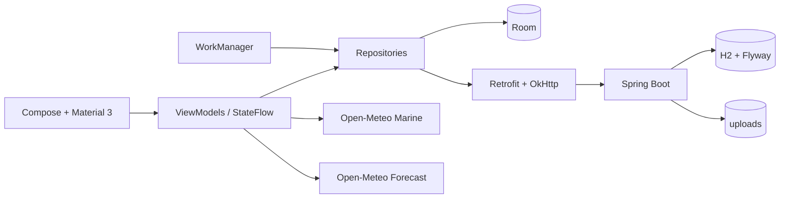

- **Patrón:** MVVM + Repository + inyección manual (`AppContainer`).
- **UI:** una sola actividad, Navigation Compose, Material 3.
- **Red:** Retrofit + Gson; interceptor JWT y manejo de 401.
- **Offline:** Room + WorkManager; la UI observa Flows.
- **Backend:** capas controller → service → repository → JPA.

## Stack y herramientas utilizadas

| Área | Tecnología / herramienta |
|---|---|
| IDE | Android Studio, JBR 21+ |
| Lenguaje | Kotlin 2.0.21, Java 21 |
| UI | Jetpack Compose, Material 3, Navigation Compose 2.9.8 |
| Build | Gradle 9.5.0, AGP 9.3.3, compileSdk/targetSdk 37, minSdk 24 |
| Persistencia local | Room 2.8.5 |
| Red | Retrofit 2.12.0, OkHttp, Gson |
| Background | WorkManager 2.12.0 |
| Cámara/imagen | CameraX 1.7.0, Coil 2.7.0, Telephoto 0.19.0 |
| Seguridad local | Android Keystore, EncryptedSharedPreferences, PBKDF2-HMAC-SHA256 |
| Backend | Spring Boot 3.5.16, Spring Data JPA, Spring Security, JJWT 0.12.6 |
| Base de datos | H2 archivo, Flyway |
| Documentación API | springdoc-openapi 2.8.13, Swagger UI, Postman |
| API externa | Open-Meteo Marine + Forecast |
| Pruebas | JUnit, MockK, Robolectric 4.16.1, coroutines-test, Compose UI Test, Espresso |
| Infraestructura | Docker, Render, Cloudflare Tunnel (desarrollo) |
| Control de versiones | Git, GitHub |
| Informes | Generador Python + python-docx |

## Estructura del repositorio

```text
app/                         App Android
  src/main/java/com/example/aquasample/
    ui/                      Pantallas, componentes y ViewModels
    data/                    Room, Retrofit, repositorios y sync
    di/                      AppContainer
  src/test/                  87 pruebas unitarias
  src/androidTest/           6 pruebas instrumentadas
backend/                     API Spring Boot
  src/main/java/             Controllers, services, repos, security
  src/main/resources/        application.properties, Flyway
  src/test/                  6 pruebas backend
docs/                        Documentación, capturas e informes
  screenshots/               Evidencia visual
  informe/                   Informe de estado v2–v9
  API.md, SWAGGER.md, SYNC.md, RENDER.md, RELEASE.md
postman/                     Colección de la API
Dockerfile                   Imagen para Render
render.yaml                  Blueprint de Render
dist/                        APK release firmadas
```

## API

### API propia

| Módulo | Endpoints |
|---|---|
| Auth | `POST /api/auth/login` |
| Health | `GET /api/health` |
| Muestras | `GET/POST /api/muestras`, `GET/PUT/DELETE /api/muestras/{id}`, `PATCH /api/muestras/{id}/estado` |
| Fotos | `POST /api/fotos`, `GET /api/fotos/{name}` |
| Centros | CRUD `/api/centros` |
| Tramos | CRUD `/api/tramos` |
| Usuarios | `GET/POST /api/usuarios`, `GET /api/usuarios/{id}`, `PATCH /api/usuarios/{id}/estado` |

- Swagger: https://aquasample-backend.onrender.com/swagger-ui.html
- OpenAPI: https://aquasample-backend.onrender.com/v3/api-docs
- Snapshot: [docs/openapi.json](docs/openapi.json)
- Colección Postman: [postman/](postman/)
- Detalle y ejemplos: [docs/API.md](docs/API.md)

### API externa

| API | Uso | Endpoint |
|---|---|---|
| Open-Meteo Marine | Oleaje y temperatura del mar | `https://marine-api.open-meteo.com/v1/marine` |
| Open-Meteo Forecast | Viento en m/s | `https://api.open-meteo.com/v1/forecast` |

No requieren API key. Si no hay internet, la tarjeta de condiciones queda sin datos, pero la muestra se guarda localmente.

## Testing y calidad

| Suite | Cantidad | Estado |
|---|---:|---|
| Unitarias Android | **87** | ✅ en verde |
| Backend | **6** | ✅ en verde |
| Instrumentadas / Compose UI | **6** | ✅ ejecutadas en emulador |
| **Total** | **99** | |

Comandos:

```powershell
# Unitarias Android
.\gradlew.bat :app:testDebugUnitTest

# Backend
.\gradlew.bat -p backend test

# Compose UI (requiere emulador o teléfono)
.\gradlew.bat :app:connectedDebugAndroidTest
```

Cobertura medida (JaCoCo, última ejecución):

| Capa | Cobertura de líneas |
|---|---:|
| Global | ~5,5 % (523/9575) |
| `HistoryViewModel` | 80,7 % |
| `SampleDetailViewModel` | 46,9 % |
| `SampleViewModel` | 0 % |
| `LoginViewModel` | 0 % |
| `HomeViewModel` | 0 % |
| `MuestraRepository` | 85,7 % |
| `UsuarioRepository`, `CentroCultivoRepository`, `MarineRepository` | 0 % |

> La pauta de defensa pide **>90 % en ViewModel/Repository**. Esa meta aún no se cumple; el README no declara una cobertura que no existe. El plan de mejora está en el informe v9.

## Despliegue

### Render (recomendado)

Backend público, sin depender del PC ni de la misma WiFi:

```text
https://aquasample-backend.onrender.com/
```

- Health: `/api/health`
- Swagger: `/swagger-ui.html`
- Docker + `render.yaml`
- Guía: [docs/RENDER.md](docs/RENDER.md)

> Plan Free: cold start de 30–60 s y sin disco persistente. H2 y fotos se pierden en cada redeploy. Para la defensa, abrir `/api/health` unos minutos antes.

### Local

```powershell
# Backend
.\gradlew.bat -p backend run

# Emulador o USB
adb reverse tcp:8080 tcp:8080

# App debug
.\gradlew.bat :app:installDebug
```

La app apunta por defecto a Render. Para usar el backend local: **Perfil → Servidor** y escribir `http://10.0.2.2:8080/` (emulador) o la IP del PC (WiFi).

### Docker

```powershell
docker build -t aquasample-backend .
docker run -p 8080:8080 -e AQUASAMPLE_JWT_SECRET=change-me aquasample-backend
```

## APK firmada

| Dato | Valor |
|---|---|
| Versión | 1.0.24 (`versionCode` 25) |
| Archivo | [dist/AquaSample-1.0.24-release.apk](dist/AquaSample-1.0.24-release.apk) |
| Tamaño | 19.427.327 bytes |
| SHA-256 | `6b3e340075493c573dd2fb895f9658ca42848313adaa1e1576dedb13947a356d` |
| Firma | APK Signature Scheme v2 |
| Tag | `v1.0.24` |

- Descarga directa: https://github.com/DiegoDV16/AquaSample/raw/v1.0.24/dist/AquaSample-1.0.24-release.apk
- Instrucciones: [docs/RELEASE.md](docs/RELEASE.md)
- El keystore y `keystore.properties` quedan fuera del repositorio.

## Seguridad

- JWT con expiración y validación en cada request.
- Contraseñas backend con BCrypt.
- Contraseñas locales con PBKDF2-HMAC-SHA256 (120 000 iteraciones).
- Token en `EncryptedSharedPreferences` con Android Keystore.
- Cierre de sesión automático ante 401.
- Roles: operador crea/edita; analista/admin valida y elimina; admin gestiona usuarios.
- Datos de demostración ficticios; no usar información real de ALDEMAR.

## Credenciales de demostración

| Rol | Correo | Contraseña |
|---|---|---|
| Operador | `operador@aquasample.cl` | `operador123` |
| Analista | `analista@aquasample.cl` | `analista123` |
| Administrador | `admin@aquasample.cl` | `admin123` |

## Evidencias del sistema

| Requisito | Evidencia |
|---|---|
| App funcional | APK 1.0.24 + flujo completo en capturas (login → muestra → historial → PDF) |
| Login por rol | `docs/screenshots/01-login.png`, `22-login-operador.png`, `23-login-aquasample.png` |
| Muestreo y fotos | `04-nueva-muestra-paso1.png` a `08-validacion-foto.png` |
| Historial y dashboard | `09-historial.png`, `19-dashboard-graficos.png`, `20-historial-comparacion.png` |
| Reportes | `16-informe-pdf.png`, PDF de ejemplo en `docs/ejemplos/` |
| Offline + sync | [docs/SYNC.md](docs/SYNC.md), [docs/VERIFICACION-E2E.md](docs/VERIFICACION-E2E.md), `35-notificacion.png` |
| API y Swagger | `40-swagger.png`, `41-render-health.png`, [docs/API.md](docs/API.md), [docs/openapi.json](docs/openapi.json) |
| API externa | `42-open-meteo.png`; Open-Meteo Marine/Forecast en formulario de muestra |
| Pruebas | 87 + 6 + 6; reporte HTML en `app/build/reports/tests/` |
| APK firmada | Hash SHA-256, tag `v1.0.24`, `docs/RELEASE.md` |
| Despliegue | Render + `Dockerfile` + `render.yaml`; [docs/RENDER.md](docs/RENDER.md) |
| Modificación en vivo | [docs/ENSAYO-MODIFICACION.md](docs/ENSAYO-MODIFICACION.md) |
| Informe técnico | [Informe v9](docs/informe/AquaSample-Estado-del-Sistema-v9.docx) |

## Documentación

- [Diseño y arquitectura](docs/DESIGN.md)
- [API y autenticación](docs/API.md)
- [Swagger y OpenAPI](docs/SWAGGER.md)
- [Sincronización en el teléfono](docs/SYNC.md)
- [Despliegue en Render](docs/RENDER.md)
- [Conectar la app con el backend](docs/DEPLOY.md)
- [APK y firma](docs/RELEASE.md)
- [Verificación E2E](docs/VERIFICACION-E2E.md)
- [Verificación final](docs/VERIFICACION-FINAL.md)
- [Ensayo de modificación en vivo](docs/ENSAYO-MODIFICACION.md)
- [Trello](docs/TRELLO.md)
- [Backend](backend/README.md)
- [Informe de estado v9](docs/informe/AquaSample-Estado-del-Sistema-v9.docx)

## Estado y limitaciones

**Implementado**

- App Android completa con Compose/Material 3, MVVM, Room, Retrofit y WorkManager.
- Cámara, conteo asistido, historial, dashboard, PDF/CSV y respaldo.
- Backend Spring Boot con JWT, H2, Flyway, Swagger y fotos.
- Sincronización bidireccional y resolución de conflictos de IDs.
- Render público y Docker validado.
- 99 pruebas automatizadas.

**Limitaciones conocidas**

- Cobertura ViewModel/Repository por debajo del 90 % exigido en la pauta.
- Plan Free de Render sin persistencia; cold start.
- Tablero Trello documentado pero no creado en la nube.
- Pruebas instrumentadas ejecutadas en emulador; falta repetir cámara/conteo en teléfono físico para la defensa.
- La modificación en vivo está ensayada parcialmente; falta el cambio completo cronometrado.
- Open-Meteo requiere internet; sin red no hay condiciones marinas.

## Autoría

Proyecto académico **DSY1105 Desarrollo de Aplicaciones Móviles**, Evaluación Parcial 5, para **ALDEMAR SpA**.

- Repositorio: [DiegoDV16/AquaSample](https://github.com/DiegoDV16/AquaSample)
- Backend: [aquasample-backend.onrender.com](https://aquasample-backend.onrender.com/)
